# Flyback Converter: Snubber Design and Debugging Log

This section continues the flyback notes (figures 1 to 11 are in the earlier sections). It covers how the drain voltage went from heavy ringing and voltage spikes to a clean, damped waveform, and the problem that came up along the way: the output diode breaking down because its voltage rating is too low.

> **Images:** save each screenshot into an `images/` folder using the file names below so the links work.

---

## Circuit at a glance

| Part | Value | Role |
|---|---|---|
| V1 | 24 V | Input |
| L1 / L2 | 20.7 µH / 51 µH, `K1 L1 L2 1` | Flyback transformer, n = √(51/20.7) ≈ 1.57 |
| Lik | 0.621 µH | Primary leakage inductance (~3% of L1) |
| M1 | MCQ15N10YA (100 V, 15 A, N-channel) | Low-side switch |
| V2 | `PULSE(0 15 0 10n 10n 4.5u 10u)` | Gate drive, 100 kHz, D = 0.45 |
| D1 | 1N5822 | Output diode (the current problem) |
| C1, C2 | 47 µF each | Output caps |
| R1, R2 | 12 Ω each | Load (6 Ω total) |

---

## Step 1: Add the RCD snubber (clamp)

The RCD snubber is D2, R3 and C3:

- **D2 anode** goes to the MOSFET drain, **cathode** to the clamp node.
- **R3 and C3 in parallel** go between the clamp node and V1+ (not ground).

When M1 turns off, the energy stored in Lik (½·Lik·Ipk²) has nowhere to go, so it forces the drain voltage up. D2 steers that current into C3, which holds the drain at a flat clamp level. R3 then bleeds C3 down, turning the leakage energy into heat.

Starting values: R3 = 390 Ω, C3 = 560 nF, D2 = UF4007.

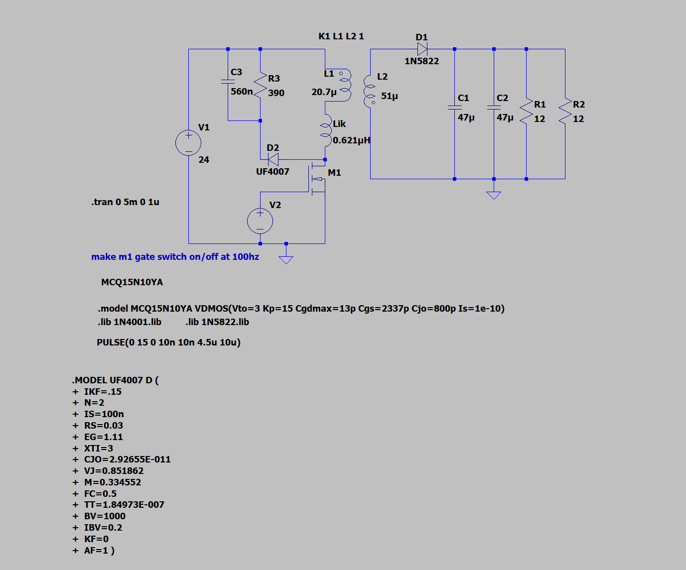
**Figure 12:** Schematic with the RCD snubber (R3, C3, D2) added on the primary side.

### Design equations

- Clamp power: P = ½ · Lik · Ipk² · fs · Vc / (Vc − Vr)
- Resistor: R = Vc² / P
- Capacitor: C = 1 / (ripple fraction × R × fs), ripple usually 5 to 10%
- Choose Vc ≈ 2 to 2.5 × Vr, and keep Vin + Vc ≤ ~80% of the MOSFET's Vds rating

**Why R3 sets the clamp voltage:** at steady state, the energy pushed into C3 each second equals what R3 burns (Vc²/R). Bigger R3 means a higher clamp voltage but less loss. Smaller R3 means a lower clamp voltage but more loss. C3 only sets the ripple on the clamp voltage, not its average.

---

## Step 2: Probing the drain

Probe the MOSFET drain (the node where Lik, D2's anode and M1's top pin meet).

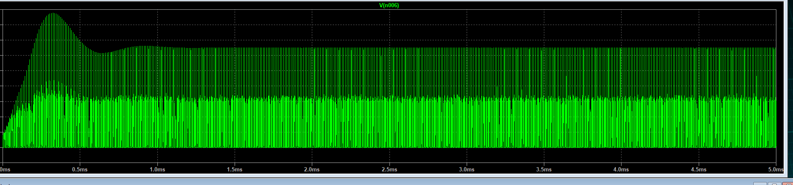
**Figure 13:** Drain voltage over the full 5 ms. Each stripe is one 10 µs cycle. The startup envelope overshoots around 0.3 ms and settles by ~1.2 ms. Too zoomed out to judge damping.

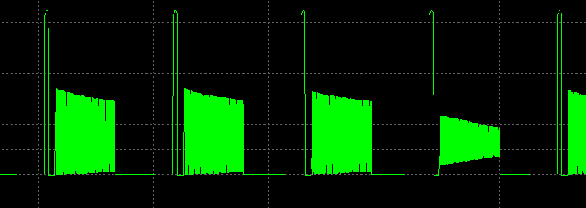
**Figure 14:** Zoomed in to a few cycles. Each cycle has a clamp spike, then a solid block of high-frequency ringing for most of the off-time. Heavily underdamped (ζ well under 0.05).

### Why the RCD alone doesn't stop the ringing

The RCD only conducts when the drain is above the clamp voltage. Once Lik's current reaches zero, D2 turns off and R3/C3 are disconnected. Lik then resonates with the MOSFET's output capacitance (Coss) with almost no resistance, so it rings.

- RCD snubber: limits the **peak** voltage.
- RC snubber: damps the **ringing**.

The circuit needs both.

**Timestep note:** `.tran 0 5m 0 1u` (1 µs max step) is too coarse to resolve a ~12 MHz ring. Use `.tran 0 5m 4.9m 5n` instead.

---

## Step 3: Add the RC snubber (drain to ground)

Sizing, with Coss ≈ 300 pF from the MOSFET model:

- Ring frequency: f₀ = 1 / (2π√(Lik·Coss)) ≈ 12 MHz
- Characteristic impedance: Z₀ = √(Lik/Coss) ≈ 45 Ω
- **R4 ≈ Z₀ → 47 Ω**
- **C4 ≈ 3 to 4 × Coss → 1 nF**
- Loss ≈ C · V² · fs ≈ 0.5 W
- Damping: ζ ≈ Z₀ / (2R) ≈ 0.5

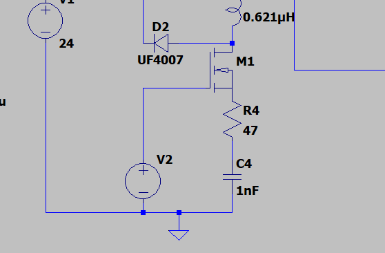
**Figure 15:** First attempt, wired wrong. R4 and C4 were placed in series between M1's source and ground, so the full switch current had to flow through them, and C4 blocks DC.

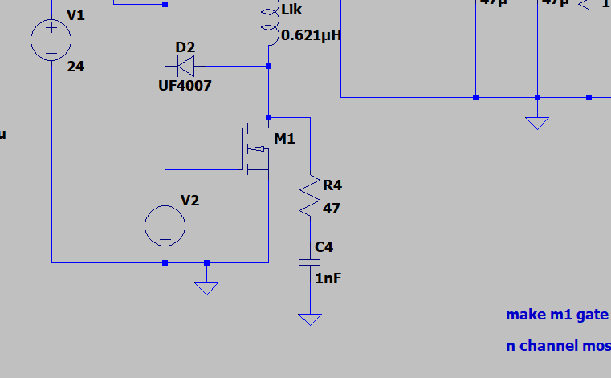
**Figure 16:** Corrected wiring. M1's source goes straight to ground, and R4 + C4 run from the drain to ground, in parallel with M1.

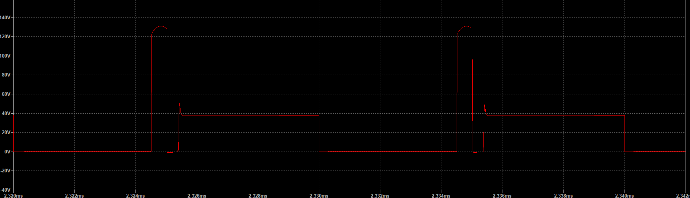
**Figure 17:** With the RC snubber, the ringing is gone. The drain settles to the ~38 V plateau with one small bump. However, the clamp sits at ~130 V, above M1's 100 V rating. The dip to 0 V after the clamp is the large swing being caught by M1's body diode.

---

## Step 4: Lowering the clamp voltage

R3 was lowered to 40 Ω (C3 = 1 µF) to pull the peak under 100 V.

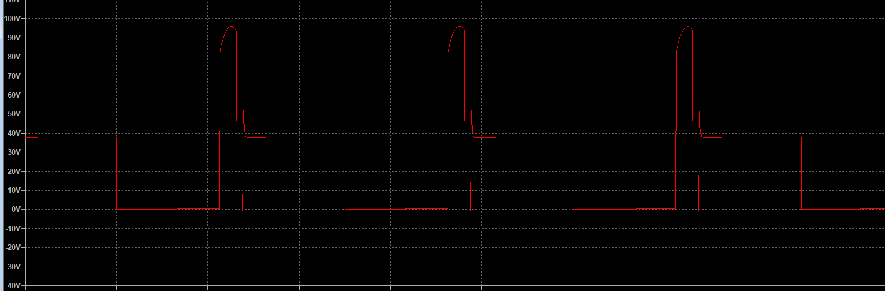
**Figure 18:** With R3 = 40 Ω, the drain peak is ~96 V. Under the rating, but with almost no margin. The clamp top slopes upward (C3 charging during each clamp event).

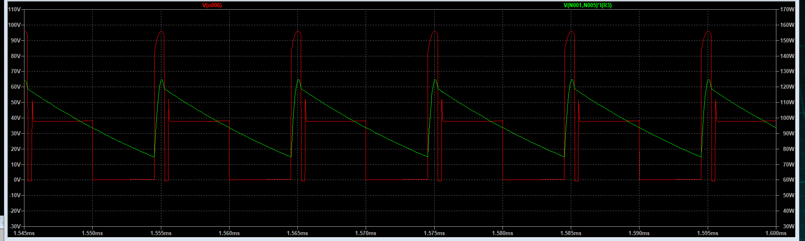
**Figure 19:** Drain voltage (red) and R3 power (green). R3's power swings between ~75 W and ~125 W every cycle.

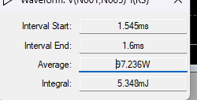
**Figure 20:** Average R3 power over steady state: **97.2 W**. This is more than the ~78 W delivered to the load, so efficiency is under 50%.

How to measure this in LTspice: Alt+click R3 in the schematic to plot its power, zoom to steady state, then Ctrl+click the trace label to see the average.

---

## Step 5: Finding the real problem

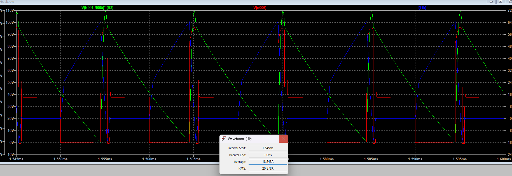
**Figure 21:** Primary current `I(Lik)`. Peak ≈ **65 A**, average 18.5 A, RMS 29.9 A. During the on-time the current ramps at ~10 A/µs. With 24 V across 20.7 µH it should only ramp at 24 / 20.7µ ≈ **1.2 A/µs**, so the primary was acting like only ~2.3 µH.

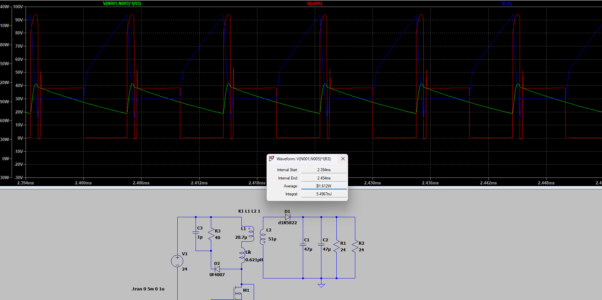
**Figure 22:** Load lightened (R1 = R2 = 24 Ω). R3's average power only dropped from 97 W to **91.6 W**. If the clamp were absorbing normal leakage energy, halving the load should have cut it a lot. So the snubber wasn't the root cause.

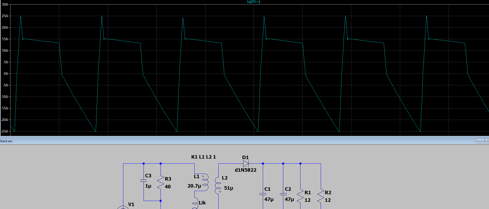
**Figure 23:** Output diode current `I(D1)`. During every on-time, D1 conducts **backwards, down to −25 A**. In a flyback, D1 must carry zero current while M1 is on.

---

## Current problem: D1 voltage rating too low

While M1 is on, D1 must block the reflected input voltage plus the output voltage:

V_reverse ≈ n · Vin + Vout ≈ 1.57 × 24 + ~25 ≈ **60+ V**

The **1N5822 is a 40 V Schottky**, so it breaks down and conducts in reverse every cycle. That one fault explains everything seen in Figures 17 to 23:

- The secondary is effectively shorted into the output during the on-time, so the primary doesn't see its full 20.7 µH (steep current ramp).
- The primary peak current climbs to ~65 A, so the leakage energy ½·Lik·Ipk² is huge.
- R3 has to burn ~95 W to hold the drain voltage down, regardless of load.

Lowering R3 was a reasonable reaction to the high drain voltage, but no R3 value could fix this, because the problem is on the secondary side.

---

## Next steps

1. **Replace D1** with a diode rated **≥ 100 V** that can carry a few amps (e.g., a 100 V Schottky such as MBRS1100, or an ultrafast like MURS320). In LTspice: right-click D1 → Pick New Diode → sort by Vrrm.
2. **Verify** that `I(D1)` is zero during the on-time and the primary current ramps at ~1.2 A/µs.
3. **Re-measure** the peak of `I(Lik)` and recompute R3 and C3 with the design equations above.
4. **Sweep R3** to fine-tune instead of trial and error. Set R3's value to `{Rclamp}` and add:

```spice
.step param Rclamp list 68 120 220 390
.meas TRAN Vpk MAX V(n006) FROM 4.9m TO 5m
.meas TRAN Pr3 AVG V(N001,N005)*I(R3) FROM 4.9m TO 5m
```

   Open View → SPICE Error Log and pick the largest R3 that keeps the drain peak under ~80 V.
5. **Use the correct timestep:** `.tran 0 5m 4.9m 5n`.

**Expected result:** R3 goes back up into the 120 to 390 Ω range, the drain peak sits under 80 V, and the clamp loss drops from ~95 W to a few watts.
